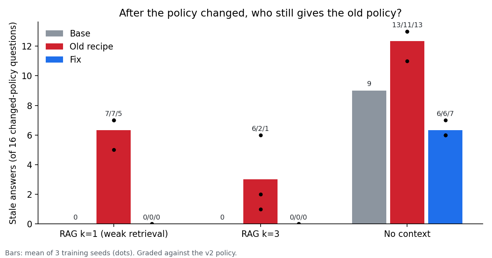
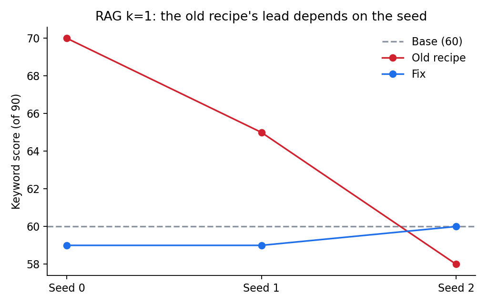

# When a fine-tune keeps giving the old policy

A small, end-to-end experiment on [Fireworks](https://fireworks.ai): a support assistant for a fictional retailer, Alder & Co.,
answers returns questions. Then the returns policy changes. Which setups keep up, which keep telling customers the old
rules, and does fixing the training data fix it?



**Findings (synthetic data, 90 questions, details below):**

1. **A LoRA tuned on the policy facts kept giving the old policy after it changed,** even with the new policy retrieved into
   the prompt. With weak retrieval (1 section), it gave a v1 value ("30 days", "$6.95", "7 days") on 5–7 of 16 changed-policy
   questions across three training seeds. The untuned base model did that 0 times.
2. **Its headline score depended on the seed.** Same data, same settings, only the shuffle order changed: 70, 65 and 58 out
   of 90, against a base of 60. A release gate on the average would pass or fail depending on luck. A gate on the
   changed-policy slice would have blocked all three.
3. **Training on retrieved context instead removed the stale answers: 0 in all six fix runs with retrieval.** Each training
   prompt carried retrieved policy sections (about 1 in 5 deliberately wrong) and the answer used only those sections, so
   the model learned to read and abstain rather than memorize. Its scores were steady across seeds (59, 59, 60).
4. **But the fix didn't beat the untuned model.** By keyword grading it tied the base model; the LLM judge put it 6–7
   points ahead at k=1, which I haven't broken down. Without context it lost the old tune's learned escalation (0/11). The
   honest read: for knowledge that changes, the tune bought little that retrieval and the base model didn't already do.
5. **Retrieval is the ceiling.** BM25 found a right section 78% of the time at k=3 and 60% at k=1. Most remaining
   failures are safe abstentions on retrieval misses, so better retrieval would move the score more than any tune here.

## Setup

- **Policy:** 13 short sections (`data/policy_v1.md`). v2 changes three values: return window 30 → 45 days, return shipping
  $6.95 → free, price adjustment window 7 → 14 days.
- **Eval:** 90 questions (`data/questions_large.jsonl`), each tagged: fact, edge, changed (16, depend on a v2 change),
  escalate (11, legal threats, chargebacks, fraud, injuries, refunds over $300), silent (15, not in the policy, so the right
  answer is "I don't have that, here's a human") and adversarial (7). The first 31 are the original set (`data/questions.jsonl`).
- **Graders:** keyword checks per question (`run_eval.py`), plus an LLM judge (`judge.py`, DeepSeek V4.1 Flash) on every
  keyword failure and a 20% sample of passes, which also labels failures as stale, invented, wrong, abstained or missed escalation.
- **Models:** DeepSeek V4.1 Flash on serverless inference for the prompt/RAG comparison. Muse Glimmer 30B for LoRA, trained
  and sampled inside Fireworks Serverless Training sessions (rank 16, 3 epochs, 33 steps), so nothing was deployed.
- **Training data:** written by Kimi K3 as the teacher. Old recipe: 164 examples with no policy in the prompt, so the facts
  go into the weights. Fix: 167 examples with retrieved v1 sections in the prompt and answers grounded only in them
  (`make_sft_data.py --context`). In the fix data, 38% of answers say "I don't have that information" versus 1% in the old.

## Results

All numbers below are regenerated by `python summarize.py` into [`results/SUMMARY.md`](results/SUMMARY.md).

**Prompting and RAG (DeepSeek V4.1 Flash, 90 questions):**

| Setup | Keyword score | Judge-adjusted | Changed right | Escalate | Silent |
|---|---:|---:|---:|---:|---:|
| No context, graded v1 | 34/90 | 44/90 | 9/16 | 0/11 | 2/15 |
| Whole policy, v2 | 83/90 | 89/90 | 16/16 | 11/11 | 14/15 |
| RAG k=3, v2 | 68/90 | 76/90 | 10/16 | 10/11 | 15/15 |
| RAG k=1, v2 | 64/90 | 70/90 | 8/16 | 9/11 | 15/15 |

Putting the whole policy in the prompt is near-perfect at this size (13 sections) and updates the moment the document does.
RAG matters when the knowledge base is too big to fit, and then retrieval quality decides the score.

**LoRA, graded against v2, three shuffle seeds each:**

| RAG k=1 | Keyword score | Judge-adjusted | Stale (of 16) | Escalate | Silent |
|---|---:|---:|---:|---:|---:|
| Base | 60 | 60 | 0 | 11/11 | 15/15 |
| Old recipe | 70 / 65 / 58 | 69 / 68 / 62 | 7 / 7 / 5 | 10 / 11 / 10 | 15 / 15 / 15 |
| Fix | 59 / 59 / 60 | 66 / 67 / 66 | **0 / 0 / 0** | 9 / 10 / 11 | 15 / 15 / 15 |

| No context | Keyword score | Stale (of 16) | Escalate | Silent |
|---|---:|---:|---:|---:|
| Base | 26 | 9 | 0/11 | 0/15 |
| Old recipe | 53 / 51 / 57 | 13 / 11 / 13 | 4 / 6 / 8 | 11 / 10 / 12 |
| Fix | 22 / 26 / 17 | 6 / 6 / 7 | 0 / 0 / 0 | 1 / 7 / 0 |

The k=3 table is in `results/SUMMARY.md`: same pattern, with the old recipe at 6 / 2 / 1 stale and the fix at 0 / 0 / 0.



## What I'd do with this in production

- **Keep changing knowledge in retrieval or the prompt; tune for behavior.** Escalation, tone and what not to promise
  are stable. Return windows and fees are not.
- **If you tune, train on the same context the model will see,** including retrieval misses, and make "I don't know"
  a real share of the data. The old data had 2 such examples in 167, and the old tune invented rules accordingly.
- **Gate releases on slices, not the average.** Hard floors on changed-policy, escalation and not-in-policy cases. Here
  the average said "ship" for one seed and "don't" for another; the stale-answer slice said "don't" every time.
- **Check that the retrieved text contains the fact, not just that the right section came back.** A retrieval "hit" on
  one of two relevant sections still let the old recipe answer from memory.
- **Fix retrieval first.** At 60–78% hit rates, retrieval caps every setup here.

## Limits

- Everything is synthetic: the brand, policy, questions and training data. 90 questions is small; one question is about 1 point.
- The two graders disagree often. On the answers the judge saw, it called 213 of 871 keyword failures correct (the keyword
  lists are strict about phrasing) and disagreed with 52 of 373 keyword passes. The judge makes its own mistakes, so treat
  absolute scores as rough. The stale count is exact string matching on old values and is the most reliable number here.
- Seeds vary only the training shuffle order. Each recipe has one teacher-written dataset, generated at temperature 0.7.
- One new eval question (q72) is close to an old-recipe training example. Sampling is at temperature 0; on the original
  31 questions, rerunning the DeepSeek setups moved scores by 0–3 questions.
- The fix and the old recipe differ in more than one way: different prompts in training, more abstain examples, and
  different teacher answers. This shows the recipe works, not which ingredient matters most.

## Reproduce

```bash
cp .env.example .env   # add FIREWORKS_API_KEY
python run_eval.py --mode rag --policy v2 --k 1 --model accounts/fireworks/models/deepseek-v4p1-flash --questions data/questions_large.jsonl --suffix _q90
python make_sft_data.py --teacher accounts/fireworks/models/kimi-k3 --per-section 12 --context
python clean_sft_data.py data/sft_train_v1_context.jsonl
PY=<cookbook>/training/.venv/bin/python ./run_sweep.sh   # LoRA sessions; needs github.com/fw-ai/cookbook (training/)
python judge.py results/*_q90.jsonl results/lora/q90-*/tuned_rag_v2_k1_gradedv2.jsonl
python summarize.py
```

`run_eval.py --mock` runs the pipeline offline. `results/lora/alder-v1-*` holds the original 31-question runs.

## Cost

About $2–3 of Fireworks credit for the 90-question round: Muse Glimmer sampling in the training sessions (250k prefill +
104k sampled tokens, about $1.00), the judge (about $0.35), DeepSeek runs (about $0.07) and the Kimi K3 teacher data (not
metered by the script; roughly $0.5–0.7 at list price). LoRA training on Muse Glimmer 30B was free under a Fireworks
promotion that ran through November 30, 2026.
